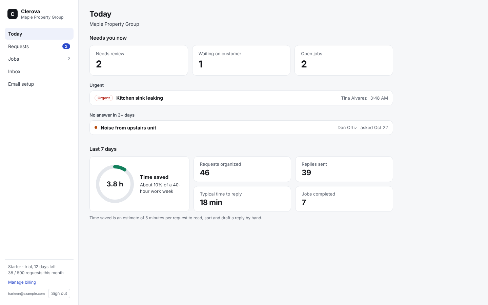
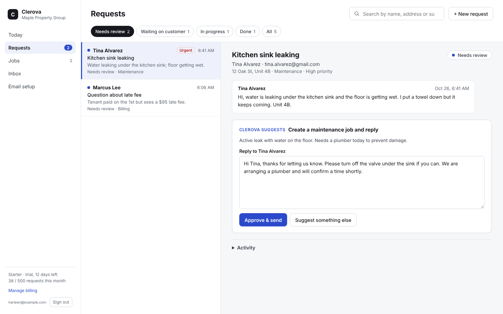
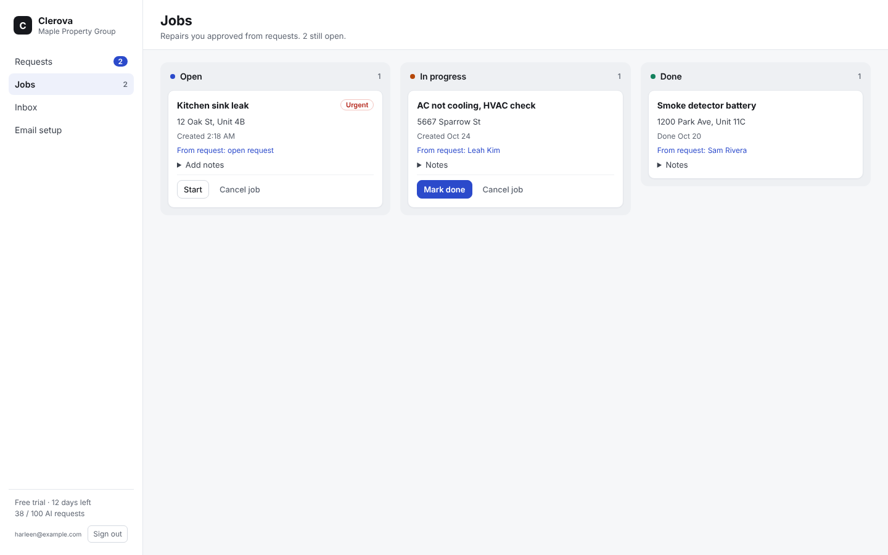
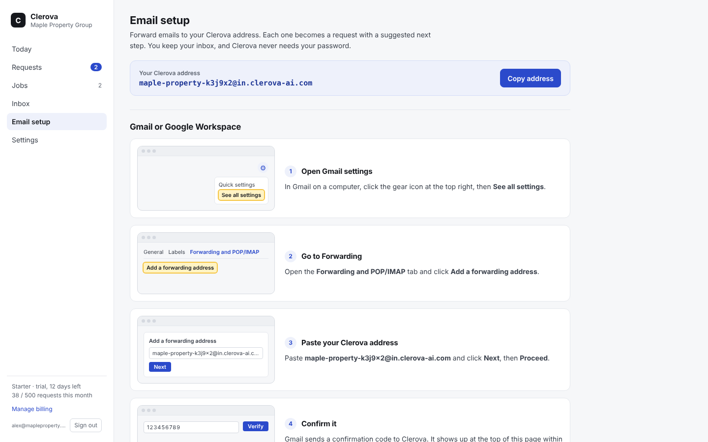

# Clerova

**Your requests inbox, organized by AI and approved by you.**

Clerova turns the emails and messages a property team receives into
structured requests. For each one it extracts the details, recommends the
next step and drafts a reply. Nothing is sent or created until a person
approves it.

Property management is the live focus.

**App:** https://app.clerova-ai.com  
**API:** https://api.clerova-ai.com  
**Website:** https://clerova-ai.com

---

## How It Works

1. **Sign up** from the website or at app.clerova-ai.com and confirm your
   email. The website's buttons carry the email you typed and the plan you
   picked, so sign-up is filled in for you.
2. **Set up your workspace:** your name, company name, units managed and how
   you heard about Clerova.
3. **Choose a plan and add a card.** The first 14 days are free. Nothing is
   charged until the trial ends, and cancelling before then costs nothing.
4. **Forward your email** to your Clerova address (shown on the Email Setup
   page), for example `maple-property-k3j9x2@in.clerova-ai.com`. You can
   forward everything or set a filter. You can also type or paste a request
   with **New request**. A get-started checklist on the Today page walks
   through this and sends a test email for you.
5. **Clerova organizes it.** Each new request gets an address, category,
   priority and summary, a recommended next step with its reasoning, and a
   drafted reply.
6. **You review.** Edit the draft, then approve or reject. Rejecting returns
   the request so a new suggestion can be generated.
7. **Clerova acts on approval.**
   - Replies are emailed from your Clerova address with **Approve & send**.
   - Maintenance recommendations create a maintenance job that you move from
     open to in progress to completed.
   - Escalations and requests for more information stay open until you close
     them.
8. **Replies come back to the same request.** When the resident answers,
   their email joins the request's conversation and returns it to review.
   This also applies to requests closed in the last 14 days.

```text
Email forwarded              Request typed in the app
        \                          /
         v                        v
      Inbox (stored, duplicates skipped)
                   |
                   v
   AI: extract details -> recommend next step -> draft reply
                   |
                   v
          Human review (edit, approve, reject)
                   |
     +-------------+--------------+------------------+
     v             v              v                  v
 Send reply   Maintenance job   Escalate /     No action
     |        OPEN -> IN_PROGRESS  ask for info
     |           -> COMPLETED     (closed by you)
     v
 Resident replies -> back to review
```

---

## Features

- Email intake through a per-organization forwarding address (Postmark)
- AI extraction of address, category, priority and summary
- Categories: maintenance, billing, leasing, complaint, general
- AI recommendation with reasoning and a drafted reply, created
  automatically for every new request
- Human approval, with editable drafts, rejection and regeneration
- Replies sent by email from the app, threaded onto the same request
- Today page: what needs you now (to review, urgent, customers who haven't
  answered in 3+ days, open jobs) and the last 7 days, with time saved
- One Requests list with search and filters: needs review, waiting on
  customer, in progress, done
- "Approve & send" emails the edited reply in one step
- Jobs board for maintenance: open, in progress, done, with notes
- Conversation view and activity history for each request (newest first)
- Inbox view of every received email with its status, and a retry for
  failed ones
- Open sign-up with Supabase Auth (email or Google), onboarding and a free
  trial
- Settings: name, company name, sign-in email, password and billing
- Get-started checklist for new workspaces: copy the address, forward,
  send a test email, approve the first reply
- Multi-tenant organizations: each organization only sees its own data
- Stripe billing: card up front, 14-day free trial, founding prices,
  self-service billing portal
- Monthly AI quota per organization and per-client rate limits
- Responsive desktop and mobile interface

---

## Human Review

Clerova separates AI suggestions from actions.

```text
AI suggestion -> Human review -> Approved action
```

A suggestion to create a maintenance job, for example, does not create the
job until someone approves it. Suggestions have their own lifecycle:

```text
PENDING_APPROVAL -> APPROVED -> EXECUTED (reply sent)
                 -> REJECTED
```

Clerova has no access to rent ledgers, leases or other business records yet.
The AI is told not to invent facts it doesn't have, such as balances or lease
terms, so the reviewer adds them before sending.

---

## Architecture

```text
+------------------------------+     +---------------------------+
| React + TypeScript (Vite)    |     | Supabase Auth             |
| app.clerova-ai.com           |<--->| sign-up, sign-in, tokens  |
+--------------+---------------+     +---------------------------+
               | HTTPS, Bearer token
               v
+------------------------------+     +---------------------------+
| Spring Boot (Java 21)        |<----| Postmark inbound webhook  |
| api.clerova-ai.com           |---->| Postmark outbound (send)  |
|                              |     +---------------------------+
| Work items and approvals     |
| Email intake and processor   |     +---------------------------+
| Replies and threading        |---->| OpenAI (structured output)|
| Accounts, trials, AI quota   |     +---------------------------+
+--------------+---------------+
               |
               v
+------------------------------+
| PostgreSQL (Supabase)        |
| Flyway migrations, RLS on    |
+------------------------------+

Hosting: Render (frontend and backend), Supabase (database and auth),
Postmark (email), Stripe (billing), Cloudflare (DNS)
```

### Tech Stack

- **Backend:** Java 21, Spring Boot, Spring Security (OAuth2 resource
  server), Spring Data JPA, Flyway, PostgreSQL, OpenAI Java SDK, Maven
- **Frontend:** React, TypeScript, Vite, `@supabase/supabase-js`
- **Website:** React + Vite landing page (`website/`)
- **Testing:** JUnit and Spring Boot Test on H2 (PostgreSQL mode), with
  separate AI evaluation tests
- **Infrastructure:** Render, Supabase, Postmark, Cloudflare, Docker Compose
  for local PostgreSQL

---

## Domain Model

| Entity | What it is |
| --- | --- |
| Organization | A customer workspace with its plan, trial end date, AI quota and forwarding address |
| Work item | One request: original message, summary, address, category, priority, status |
| Proposed action | Clerova's suggestion for a work item: action type, reasoning, draft and final reply |
| Maintenance request | A job created from an approved maintenance suggestion |
| Inbound / outbound message | Emails received and sent, linked to their work item |
| Work item event | The activity history shown on each request |

Work item statuses:

```text
NEW, WAITING_FOR_APPROVAL, IN_PROGRESS, WAITING_FOR_INFORMATION,
ESCALATED, COMPLETED, CANCELLED
```

Action types:

```text
CREATE_MAINTENANCE_REQUEST, RESPOND_TO_CUSTOMER,
REQUEST_MORE_INFORMATION, ESCALATE_TO_HUMAN, NO_ACTION
```

Completing or cancelling a maintenance job also completes or cancels its
work item. A work item can't be closed while its maintenance job is open.

---

## Email Intake

```text
Email forwarded to <token>@in.clerova-ai.com
        |
        v
Postmark inbound webhook -> stored (duplicates skipped)
        |
        v
Background processor (every 5 seconds)
  - automated or bulk email ........ Ignored (can be processed anyway)
  - Gmail forwarding confirmation .. Ignored, code shown on Email Setup
  - reply to a request ............. Added to that request's conversation
                                     and returned to review
  - anything else .................. New work item + AI suggestion
```

- Replies go out from the organization's Clerova address. Their reply-to
  address carries the work item (`token+wi-<id>@...`), so answers thread
  onto the same request even if the mail client drops the threading
  headers. In-Reply-To and References headers are matched too.
- Requests closed in the last 14 days reopen when the customer replies.
  Older ones start a new request.
- Each new email uses two AI requests from the monthly quota (extraction and
  suggestion). AI failures are retried after 1 minute and then 5 minutes.
  The Inbox shows the reason for any failure, and failed emails can be
  retried from there.
- Attachment names, types and sizes are recorded. File contents are not
  stored yet.

---

## API Overview

```text
GET  /api/health

GET  /api/me
PATCH /api/me                                    ({"fullName":"...","organizationName":"..."})
POST /api/onboarding

GET  /api/billing/offer
POST /api/billing/checkout                        ({"plan":"STARTER","interval":"month"})
POST /api/billing/checkout/{sessionId}/complete
POST /api/billing/portal
POST /api/billing/upgrade                         (Starter to Growth)
POST /api/stripe/webhook                          (Stripe webhook, signed)

GET  /api/summary                                 (last 7 days, for Today)

GET  /api/inbox
POST /api/inbox/{id}/reprocess
GET  /api/email-settings
POST /api/inbound/postmark                        (Postmark webhook, basic auth)

GET  /api/work-items                              (?closed=true: closed in the last 30 days)
GET  /api/work-items/{id}
POST /api/work-items                              (creates and suggests)
POST /api/work-items/{id}/close
GET  /api/work-items/{id}/conversation
GET  /api/work-items/{id}/events

GET  /api/work-items/{id}/proposed-actions
POST /api/work-items/{id}/proposed-actions        (new suggestion after a rejection)
GET  /api/work-items/proposed-actions/latest
POST /api/work-items/proposed-actions/{id}/approve
POST /api/work-items/proposed-actions/{id}/reject
POST /api/work-items/proposed-actions/{id}/send-reply

GET   /api/maintenance-requests
PATCH /api/maintenance-requests/{id}
```

Every route except `/`, `/api/health` and the Postmark and Stripe webhooks needs a
Supabase access token (`Authorization: Bearer <token>`), and data is scoped
to the user's organization.

```http
POST /api/work-items
Content-Type: application/json

{ "message": "Water is leaking from the bathroom sink at 225 Market Street." }
```

```http
POST /api/work-items/proposed-actions/{id}/approve
Content-Type: application/json

{ "finalResponse": "Optional edited reply. Defaults to the AI draft." }
```

Requests that call the AI are rate limited per client and per day (`429`),
and count against the organization's monthly quota (`429
AI_QUOTA_EXCEEDED`). An expired trial returns `403 TRIAL_EXPIRED`, but
existing data stays readable.

---

## Running Locally

Prerequisites: Java 21, Node.js, Docker, an OpenAI API key and a Supabase
project (for sign-in).

```bash
git clone git@github.com:harleen-ghuman/clerova.git
cd clerova
docker compose up -d                  # local PostgreSQL
```

**Backend:**

```bash
cd backend
export OPENAI_API_KEY="..."
export SUPABASE_URL="https://<project-ref>.supabase.co"
./mvnw spring-boot:run                # http://localhost:8080
```

**Frontend:** copy `frontend/.env.example` to `frontend/.env.local` and fill
in the Supabase URL and anon key.

```bash
cd frontend
npm install
npm run dev                           # http://localhost:5173
```

Add `http://localhost:5173` to the Supabase redirect URLs so confirmation
links work locally. Email intake stays off locally unless the Postmark
variables are set. You can still type requests in the app.

Never commit API keys or passwords. `.env.local` is git-ignored.

---

## Configuration

### Backend

| Variable | Purpose |
| --- | --- |
| `OPENAI_API_KEY` | OpenAI key |
| `DATABASE_URL`, `DATABASE_USERNAME`, `DATABASE_PASSWORD` | PostgreSQL connection (Supabase session mode, port 5432) |
| `SUPABASE_URL` | Supabase project URL, used to verify access tokens |
| `CORS_ALLOWED_ORIGIN` | App origin, e.g. `https://app.clerova-ai.com` |
| `INBOUND_EMAIL_DOMAIN` | e.g. `in.clerova-ai.com`; enables email intake |
| `INBOUND_WEBHOOK_PASSWORD` | Basic-auth password for the Postmark webhook |
| `POSTMARK_SERVER_TOKEN` | Enables sending replies |
| `PORT` | Server port (default 8080) |
| `SUPPORT_EMAIL` | Reply-to for account emails (default hello@clerova-ai.com) |
| `STRIPE_SECRET_KEY` | Turns billing on (a plan is then required to use AI) |
| `STRIPE_WEBHOOK_SECRET` | Signing secret of the Stripe webhook endpoint |
| `APP_URL` | Where Stripe sends users back, e.g. `https://app.clerova-ai.com` |

Optional:

| Variable | Default |
| --- | --- |
| `TRIAL_DAYS` | 14 |
| `TRIAL_AI_MONTHLY_LIMIT` | 100 (only when billing is off) |
| `STARTER_MONTHLY_REQUESTS`, `GROWTH_MONTHLY_REQUESTS` | 500, 1500 |
| `FOUNDING_SPOTS` | 20 |
| `AI_RATE_LIMIT_PER_CLIENT_PER_MINUTE` | 10 |
| `AI_RATE_LIMIT_GLOBAL_PER_DAY` | 500 |
| `DB_POOL_SIZE`, `DB_POOL_MIN_IDLE` | 5, 2 |
| `INBOUND_WEBHOOK_USERNAME` | postmark |
| `EMAIL_PROCESSING_INTERVAL_MS` | 5000 |
| `SUPABASE_JWT_SECRET` | only for projects on the legacy JWT secret |
| `OPENAI_BASE_URL`, `POSTMARK_API_URL`, `STRIPE_API_URL` | official endpoints |
| `SHOW_SQL`, `FORMAT_SQL` | false |

The connection pool is kept small because the Supabase session pooler has a
fixed client limit, and old and new instances overlap during a Render
deploy.

### Frontend

```text
VITE_API_BASE_URL
VITE_SUPABASE_URL
VITE_SUPABASE_ANON_KEY
VITE_GOOGLE_CLIENT_ID   # optional: Google's own button, so the sign-in window names this site
```

### Database

Flyway migrations live in `backend/src/main/resources/db/migration`, and
Hibernate only validates the schema. On PostgreSQL,
`db/vendor/postgresql/afterMigrate.sql` runs after every migration. It
enables row level security on every table and revokes the Supabase Data API
roles, so the public anon key can't read application data. The backend
connects as the table owner and is unaffected.

---

## Production Setup

### Supabase

- **Authentication, Email provider:** enable sign-up and keep "Confirm
  email" on. Turn "Secure email change" off, so a new email only needs a
  click from the new address (people often signed up with an old one).
- **Authentication, Google provider:** turn it on with the client ID and
  secret of a Google Cloud OAuth client (Web application) whose authorized
  redirect URI is `https://<project-ref>.supabase.co/auth/v1/callback`.
  Set the same client ID as `VITE_GOOGLE_CLIENT_ID` on the frontend, and add
  the app's address under the client's authorized JavaScript origins. The
  app then uses Google's own button, and Google's sign-in window shows the
  app's address instead of the Supabase one.
- **URL Configuration:** set the Site URL to `https://app.clerova-ai.com`
  and add it to the redirect URLs.
- **SMTP:** send auth emails through Postmark so they come from the Clerova
  domain.
- **Optional:** turn on CAPTCHA under Attack Protection.

### Postmark

1. **Inbound:** add the inbound domain `in.clerova-ai.com` (MX record to
   `inbound.postmarkapp.com`), and set the webhook URL to
   `https://postmark:<INBOUND_WEBHOOK_PASSWORD>@api.clerova-ai.com/api/inbound/postmark`.
2. **Outbound:** verify `in.clerova-ai.com` as a sender domain (DKIM and
   Return-Path records), then set `POSTMARK_SERVER_TOKEN`.
3. Set `INBOUND_EMAIL_DOMAIN` and `INBOUND_WEBHOOK_PASSWORD` on the backend.

### DNS (Cloudflare)

| Record | Value |
| --- | --- |
| `in` MX | `inbound.postmarkapp.com` |
| Postmark DKIM TXT | for `clerova-ai.com` and `in.clerova-ai.com` |
| `pm-bounces` CNAME | `pm.mtasv.net` (DNS only) |
| Root MX | Google Workspace, for `hello@clerova-ai.com` |

---

### Stripe billing

Billing stays off until `STRIPE_SECRET_KEY` is set. Set it up in test mode
first, then repeat in live mode.

1. **Products and prices.** Create two products, Starter and Growth, with
   these recurring prices. Each price needs the **lookup key** shown, since
   Clerova finds prices by lookup key.

   | Lookup key | Price |
   | --- | --- |
   | `starter_monthly` | $99 / month |
   | `starter_yearly` | $990 / year |
   | `growth_monthly` | $189 / month |
   | `growth_yearly` | $1,890 / year |
   | `founding_starter_monthly` | $79 / month |
   | `founding_starter_yearly` | $790 / year |
   | `founding_growth_monthly` | $149 / month |
   | `founding_growth_yearly` | $1,490 / year |

   Yearly prices are 10 months (two months free). The first `FOUNDING_SPOTS`
   organizations get the founding prices and keep them. The amounts shown in
   the app are in `frontend/src/utils/plans.ts`, so keep them in sync.
2. **Customer portal** (Settings → Billing → Customer portal): allow updating
   payment methods, viewing invoices, and cancelling at the end of the
   billing period. Leave plan switching off: upgrades happen in the app, so
   founding customers keep their founding price.
3. **Webhook** (Developers → Webhooks): add the endpoint
   `https://api.clerova-ai.com/api/stripe/webhook` with the events
   `checkout.session.completed` and `customer.subscription.created`,
   `.updated`, `.deleted`, `.paused` and `.resumed`. Put its signing secret
   in `STRIPE_WEBHOOK_SECRET`.
4. **Emails** (Settings → Billing → Subscriptions and emails): turn on the
   reminder before a trial ends and emails for failed payments.
5. Set `STRIPE_SECRET_KEY`, `STRIPE_WEBHOOK_SECRET` and `APP_URL` on the
   backend.

How it works:

- After onboarding, the app asks for a plan. Stripe Checkout collects a
  card and starts the 14-day trial (one trial per organization).
- Organizations can use AI while their subscription is `trialing`, `active`
  or `past_due` (Stripe retries failed payments). Otherwise existing data
  stays readable and new requests are blocked.
- Each new email or typed request counts once against the plan's monthly
  requests. Suggestions and replies on an existing request don't count.
- At 80% and at 100% of the monthly requests, owners get an email and the
  app shows a banner. On Starter both suggest upgrading to Growth, which
  upgrades the subscription in place (same billing period, founding price kept,
  the difference added to the next invoice). At the limit, new emails are saved but
  not organized until the next month; they can be retried from the Inbox
  after upgrading.
- Stripe is the source of truth. Webhooks and the return from Checkout read
  the current subscription from Stripe and copy its status, plan and dates
  to the organization.

## Admin

Sign-ups so far (run in the Supabase SQL editor):

```sql
select
  (select count(*) from auth.users) as accounts,
  (select count(*) from auth.users where email_confirmed_at is not null) as confirmed,
  (select count(*) from organizations where plan <> 'INTERNAL') as workspaces,
  (select count(*) from organizations where subscription_status in ('trialing', 'active', 'past_due')) as with_card;
```

Without billing, extend a trial or move an organization to a paid plan:

```sql
update organizations
set plan = 'STARTER', ai_monthly_limit = 1000, trial_ends_at = null
where name = 'Acme Property Group';
```

Every workspace, newest first, with its owner and billing status (an empty
status means no card yet):

```sql
select o.created_at, o.name as company, u.email, o.referral_source,
       o.plan, o.billing_interval, o.subscription_status, o.founding_customer
from organizations o
join app_users u on u.organization_id = o.id
order by o.created_at desc;
```

Where sign-ups come from (links can carry `?utm_source=instagram` or
`?ref=...`; the website passes it on to the app):

```sql
select industry, company_size, referral_source, count(*)
from organizations
where plan <> 'INTERNAL'
group by industry, company_size, referral_source
order by count(*) desc;
```

Data created before accounts existed belongs to the `Demo Property
Management` organization.

---

## Testing

```bash
cd backend && ./mvnw test        # H2 in PostgreSQL mode, runs the Flyway migrations
cd frontend && npm run build     # type-check and production build
cd frontend && npm run lint
cd website && npm run build && npm run lint
```

AI evaluation tests are kept separate so normal builds don't make live model
calls.

---

## Screenshots

**Today:** what needs you now and the last 7 days.



**Requests:** one list with filters. Each request shows the conversation and
Clerova's suggestion, ready to edit and approve.



**Jobs:** approved repairs, moved from open to in progress to done.



**Email setup:** the forwarding address and step-by-step Gmail pictures.



---

## Roadmap

- Gmail and Microsoft 365 connections (OAuth) instead of forwarding
- Attachment storage and document extraction
- Answers grounded in your own documents and records (leases, ledgers,
  policies) through retrieval (RAG)
- Vendor assignment and dispatch
- New verticals, starting with real estate brokerages
